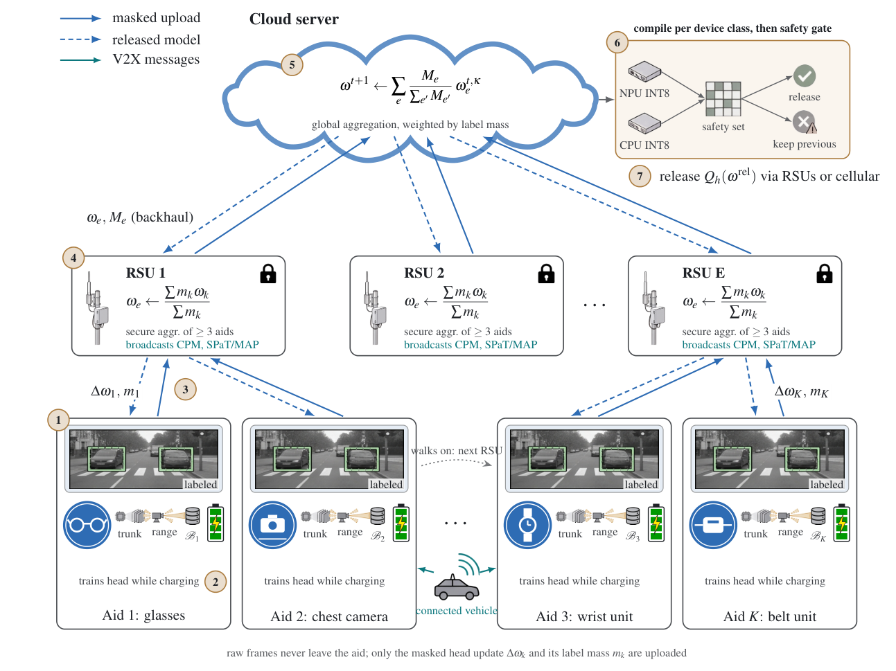
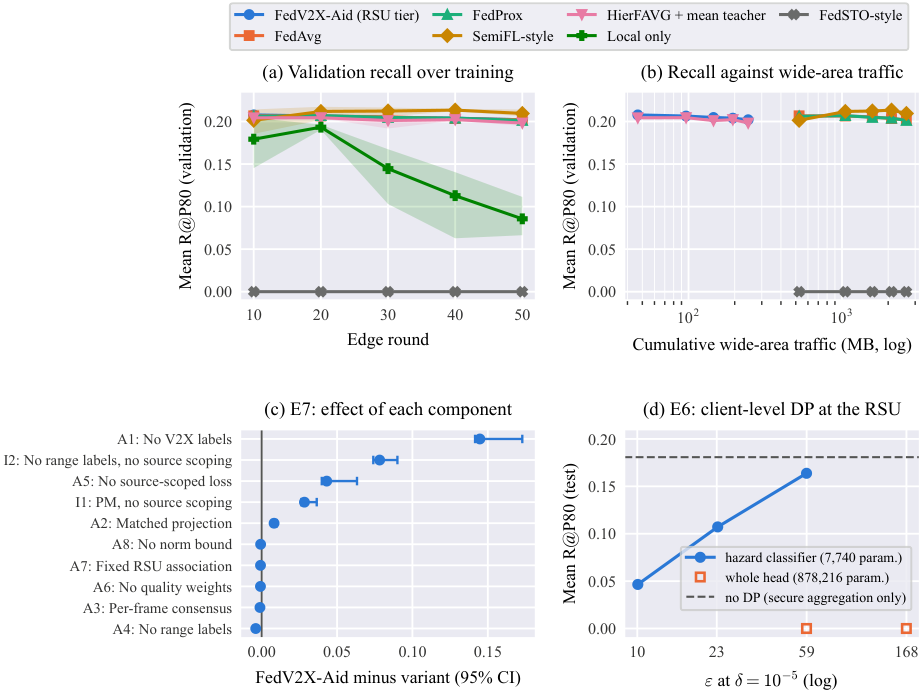

# FedV2X-Aid

**Label-free, communication-efficient federated hazard detection for assistive wearables, with V2X messages and range sensors as teachers.**

[](LICENSE)


This repository holds the code and result files behind the paper:

> Adeel Ahmad, Arshad Ali, Eraj Khan and Gahangir Hossain. *FedV2X-Aid: A V2X-Assisted Edge-IoT Framework for Label-Free Hazard Detection on Assistive Wearables.* Submitted to *Discover Internet of Things*, 2026.

<p align="center">
  
</p>
<p align="center"><em>Fig. 1 of the paper. One cloud round of FedV2X-Aid, steps 1 to 7.</em></p>

## Contents

- [What FedV2X-Aid does](#what-fedv2x-aid-does)
- [Results at a glance](#results-at-a-glance)
- [What you can check with this repository](#what-you-can-check-with-this-repository)
- [Requirements](#requirements)
- [Quick start (10 minutes)](#quick-start-10-minutes)
- [Check every number in the paper](#check-every-number-in-the-paper)
- [Reproduce the computed studies](#reproduce-the-computed-studies)
- [Reproduce the real-image experiments](#reproduce-the-real-image-experiments)
- [Regenerate the figures](#regenerate-the-figures)
- [Repository layout](#repository-layout)
- [Limitations](#limitations)
- [Troubleshooting](#troubleshooting)
- [Citation](#citation)
- [License](#license)

## What FedV2X-Aid does

AI mobility wearables (smart glasses, chest, belt and wrist units) help blind and low-vision pedestrians by detecting hazards on the device. Improving their detectors is hard. Nobody can label the users' frames, pooling street video is a privacy risk, and the low-power accelerators on these devices cannot train.

FedV2X-Aid works around all three problems:

- **Labels come from the street.** Connected vehicles broadcast where they are (CAM/BSM), and the aid's range sensors measure what is near. A consensus pose correction turns these messages into box labels even with phone-grade GNSS error.
- **Only the head trains.** The trunk stays frozen on the accelerator. Each aid trains a 0.88 M-parameter detection head while it charges, and uploads only the masked head update.
- **Roadside units aggregate.** RSUs at crossings securely aggregate the updates of the aids that walk past (at least three per round), so the wide-area network carries one model per RSU instead of one per aid.
- **A safety gate controls releases.** The cloud compiles one binary per device class and releases it only if no hazard class regresses against the previous and the first release.

## Results at a glance

All numbers below appear in the paper and are recomputed from this repository's result files by the number checker.

| Question | Result | Where in the paper |
|---|---|---|
| Can V2X messages label real images? | Consensus labels 2.6x more vehicles than matching without pose correction, at 0.814 precision, on real KITTI images under 5 m GNSS error | Table 5 |
| Hazard recall on 30 aids (mean R@P80, three seeds) | FedV2X-Aid 0.181, flat FedAvg 0.180, local-only 0.084, two self-training baselines 0.000 | Table 6, Figs. 4 and 5 |
| Wide-area traffic over 50 edge rounds | FedV2X-Aid 244.6 MB, flat FL 2,627.4 MB (9.3%) | Section 9.3, Fig. 4b |
| Which components matter? | Without V2X labels recall falls to 0.036, without the source-scoped loss to 0.138 | Table 7, Fig. 4c |
| What does client-level DP cost? | 0.164, 0.107 and 0.047 mean recall at epsilon 59, 23 and 10 | Table 10, Fig. 4d |

<p align="center">
  
</p>

The paper also reports two pre-registered negative results, and so do we here. With these weak labels the federation preserves, but does not raise, the recall of the pretrained head (hypothesis H4). No method detects curbs or crosswalks at 80% precision (H2). The pre-registration and both amendments are in [`docs/preregistration_E1.md`](docs/preregistration_E1.md).

## What you can check with this repository

| Goal | Tool | Time |
|---|---|---|
| Confirm that every computed number in the paper matches the result files | `tools/verify_manuscript_numbers.py` | seconds |
| Re-run the 15 computed studies and compare every value with the archive | `reproduce.py` | 6 min (quick) or about 2 h (full) |
| Re-run the real-image experiments E1 and E7 | `src/fl/run_e1.py`, `src/fl/run_e7.py` | about 11 h on one 8 GB GPU |
| Regenerate Figs. 3 to 6 | `tools/make_fig_*.py` | under a minute |

The evidence comes in four kinds, and the paper keeps them apart. Released scripts compute the labelling, mobility, safety-gate, privacy-accounting and convergence results. The learning results use real street images with emulated teachers. V2X geometry is also checked on real KITTI images with 3D ground truth. Model costs are measured on a development laptop. Device measurements are not part of this repository, and the number checker skips them when their file is absent.

## Requirements

- Python 3.11
- For the computed studies: the pinned CPU packages in [`requirements-computed.txt`](requirements-computed.txt)
- For the two mobility studies: SUMO 1.27, with `sumo` and `netgenerate` on your `PATH`
- For the real-image experiments: an NVIDIA GPU with 8 GB or more, CUDA 12.1, and [`requirements-gpu.txt`](requirements-gpu.txt)

The computed studies run on CPU only. They were produced on Windows 11 with an Intel Core i9-13900H and have no Windows-specific code.

## Quick start (10 minutes)

**Linux or macOS**

```bash
git clone https://github.com/adeliusa486/fedv2x-aid.git
cd fedv2x-aid
python3.11 -m venv .venv
source .venv/bin/activate
pip install -r requirements-computed.txt
python -m pytest -q                 # 36 tests pass, 1 is skipped without the GPU stack
python reproduce.py --quick         # about 6 minutes, compares every value with the archive
```

**Windows (PowerShell)**

```powershell
git clone https://github.com/adeliusa486/fedv2x-aid.git
cd fedv2x-aid
py -3.11 -m venv .venv
.venv\Scripts\Activate.ps1
pip install -r requirements-computed.txt
python -m pytest -q
python reproduce.py --quick
```

Each run writes `results/reproduced/<timestamp>/comparison.md`. For every study it lists how many values were compared and the largest absolute difference. A difference of 0 means the study reproduced exactly.

## Check every number in the paper

The number checker reads the paper's LaTeX source, finds every printed number that comes from a computation, recomputes it from `results/`, and compares it at the printed precision.

```bash
python tools/verify_manuscript_numbers.py --tex path/to/FedV2X-Aid_journal.tex --report docs/number_check_report.md
```

On the submitted version all 308 checks pass with the authors' measurement file. Without it, the device checks are skipped and every other check runs. The report in [`docs/number_check_report.md`](docs/number_check_report.md) lists each check with its source file, and [`docs/claim_ledger.csv`](docs/claim_ledger.csv) holds the same as a table.

## Reproduce the computed studies

`reproduce.py` runs exactly the commands in this table and compares each output with the archived file in `results/published/`.

```bash
python reproduce.py --list    # studies, runtimes and archived files
python reproduce.py --full    # all 15 studies, about 2 hours
```

| Paper item | Script (in `computed/`) | Archived output (`results/published/`) | Minutes |
|---|---|---|---|
| Model budget: head 878,216 of 9,486,616 parameters, 1.76 MB FP16 update | `yolo11_budget.py` | `yolo11_budget.json` | 0.0 |
| Frame-level epsilon (Supplementary Section S3) | `dp_budget.py` | `dp_budget.json` | 0.0 |
| User-level DP noise at 30, 120 and 300 aids | `dp_userlevel.py` | `dp_userlevel.json` | 2.0 |
| Fig. 3a to 3c, V2X labels under pose error | `v2x_pseudolabel_mc.py --frames 3000 --seeds 3` | `v2x_pseudolabel_mc.json` | 14.9 |
| Supplementary Fig. S3, factorial sweep (75 settings) | `v2x_mc_extended.py --study grid` | `mc_grid.json` | 35.5 |
| Camera height 1.0 and 1.3 m | `v2x_mc_extended.py --study height` | `mc_height.json` | 3.4 |
| Supplementary Table S5, parametric detector | `v2x_mc_extended.py --study det` | `mc_det.json` | 4.0 |
| Table 4, Fig. 3d to 3f, Supplementary Table S7 | `v2x_temporal_mc.py --study all --seqs 15 --seeds 3` | `mc_temporal.json` | 18.3 |
| Supplementary Table S6, misspecified error model | `v2x_temporal_mc.py --study misspec --seqs 15 --seeds 3` | `mc_temporal_misspec.json` | 5.4 |
| Table 8, Fig. 6a and 6b, SUMO mobility | `mobility_sumo.py --workdir <tmp>` | `mobility_sumo.json` | 3.0 |
| Supplementary Table S8, mobility models | `mobility_sumo.py --study modes --workdir <tmp>` | `mobility_modes.json` | 3.7 |
| Fig. 6c and 6d, Supplementary Fig. S4, safety gate | `gate_oc.py` | `gate_oc.json` | 21.3 |
| Supplementary Table S9, gate over 100 rounds | `gate_drift.py` | `gate_drift.json` | 3.1 |
| Supplementary Fig. S1a, check of Theorem 1 | `theory_check.py eps kappa` | `theory_check.json` | 4.3 |
| Supplementary Fig. S1b, check of Theorem 1 with DP | `theory_check.py dp` | `theory_check_dp.json` | 8.1 |

Minutes are from the 16 October 2026 run on an i9-13900H. `theory_check.json` also contains an older `dp` sweep in which the noise-free row was not clipped. The paper uses `theory_check_dp.json`, so the runner compares only the `eps` and `kappa` sweeps of `theory_check.json`.

**Reproduction record (16 October 2026).** Clean environment from `requirements-computed.txt`, 2 h 7 min in total.

| Result | Studies |
|---|---|
| Exact (largest absolute difference 0) | 14 of 15 studies, 8,202 values |
| Exact on every archived value, with extra fields | `mc_temporal`: all 1,900 archived values identical. The released script writes 748 more fields than an earlier version did, so the archive was replaced by its full output, and an independent second run reproduces all 2,648 values exactly (see [`results/README.md`](results/README.md)) |

Quick mode passed in 6 min 13 s. The full record is in `results/reproduced/2026-10-16_phase1/comparison.md`.

## Reproduce the real-image experiments

These runs need the GPU environment and the source images, which come from their providers (COCO, Open Images, Mapillary Vistas, MTSD, Roboflow Universe, KITTI). The image list of the merged set is in [`docs/dataset_manifest.csv.gz`](docs/dataset_manifest.csv.gz), and its 152 classes and image counts are in [`data/taxonomy/`](data/taxonomy/). Point `FEDV2X_DATA` at the merged image folder and `FEDV2X_DATA_YAML` at its dataset file (default `dataset.yaml`).

**1. Install the GPU environment**

```bash
pip install torch==2.5.1 torchvision==0.20.1 --index-url https://download.pytorch.org/whl/cu121
pip install -r requirements-gpu.txt
```

**2. Choose a work folder.** Feature caches, teacher labels and trained heads go to the folder named by `FEDV2X_WORK` (default `./work`, which git ignores). The feature cache needs about 2.87 MB per image.

```bash
export FEDV2X_WORK=/data/fedv2x_work        # Windows PowerShell: $env:FEDV2X_WORK = "D:\fedv2x_work"
```

**3. Run the pipeline**

```bash
python src/fl/build_cache.py                          # frozen-trunk features of the aids' images
python src/fl/train_round0_cache.py --stage cache     # cache the 24,000 server images
python src/fl/train_round0_cache.py --stage train     # round-0 head (validation mAP50 0.32)
for s in 0 1 2; do                                   # emulated V2X and range teacher labels, per seed
  python src/teachers/make_teacher_labels.py --seed $s --r-cond 0.669 --precision 0.841 --tag E1
done
python src/fl/run_e1.py --seeds 0 1 2                 # E1: 12 methods x 3 seeds, resumable
python src/fl/analyze_e1.py                           # statistics -> results/phase6/E1_summary.json
python src/fl/run_e7.py                               # E7: ablations on seed 0
python src/fl/analyze_e7.py                           # -> results/phase7/E7_summary.json
```

The teacher settings used for E1 (conditional recall 0.669, precision 0.841, penetration 0.5) are recorded with every run in `results/phase5/teacher_stats_E1_seed*.json`. E1 takes about 15 minutes per method and seed on an 8 GB laptop GPU, about 11 hours in total. The protocol, hypotheses and statistics were fixed before the first run and are in [`docs/preregistration_E1.md`](docs/preregistration_E1.md). Our own run outputs are in `results/phase6/` (E1), `results/phase7/` (E7) and `results/phase10/` (E6 privacy, J4 poisoning), so you can check the analysis and figures without re-training.

## Regenerate the figures

Every plotted value is read from `results/`. No coordinate is typed by hand.

```bash
python tools/make_fig_extra.py     --outdir out/   # Fig. 3 (V2X labelling) and Fig. 6 (mobility, safety gate)
python tools/make_fig_results.py   --out out/fig_results.pdf      # Fig. 4 (E1, E7, E6)
python tools/make_fig_e1_detail.py --out out/fig_e1_detail.pdf    # Fig. 5 (E1 per group, aid and seed)
```

These scripts need matplotlib, which is part of the GPU environment.

## Repository layout

```text
reproduce.py                 re-runs the computed studies and compares them with results/published/
requirements-computed.txt    pinned CPU environment of the computed studies
requirements-gpu.txt         pinned GPU environment (learning experiments, detector validation, figures)
computed/                    scripts of the 15 computed studies
src/fl/                      federation simulator, baselines, E1 and E7 runners and analysis
src/teachers/                V2X and range teachers, KITTI labelling study
src/edge/, src/metrics/      edge model costs and evaluation metrics
src/privacy/                 DP accounting
results/published/           archived outputs of the computed studies
results/phase*/              outputs of the real-image experiments
results/reproduced/          reproduction runs with comparison reports
data/                        class list, dataset counts and range-sensor bench log used by the code (with checksums)
preregistration/, docs/      pre-registration, claim ledger, number-check report, dataset manifest, figures
tools/                       number checker, manuscript checks, figure generators
tests/                       pytest suite
```

## Limitations

These are the limitations stated in the paper, listed here so nobody reads more into the code than it shows.

- The federation preserves the round-0 head but does not improve it, and no method detects rare hazards with these weak labels.
- Learning results use real images with emulated teachers. There is no field test with vehicles and no study with BLV users.
- The mobility study uses synthetic grid towns.
- On-device power and energy were not measured. Energy is reported for a development laptop only.
- Client-level DP at a meaningful budget costs most of the recall with 30 aids.

## Troubleshooting

| Problem | Fix |
|---|---|
| `sumo` or `netgenerate` not found | Install SUMO 1.27 and add its `bin` folder to `PATH`. Only the two mobility studies need it. |
| A real-image script cannot find the cache or round-0 head | Set `FEDV2X_WORK` to the same folder for every step. |
| GPU training is about five times slower than expected | On Windows, GPU memory above 8 GB silently spills into system memory. Keep the stacked-head chunk at 10 aids or fewer. |
| Non-maximum suppression is very slow | Import `torchvision` before Ultralytics so it uses the CUDA kernel. `src/fl/heads.py` already does this. |


## License

The code is released under the MIT license (see [`LICENSE`](LICENSE)). Third-party data keep the licenses of their sources. Labels derived from Mapillary Vistas and MTSD are for non-commercial research only.
